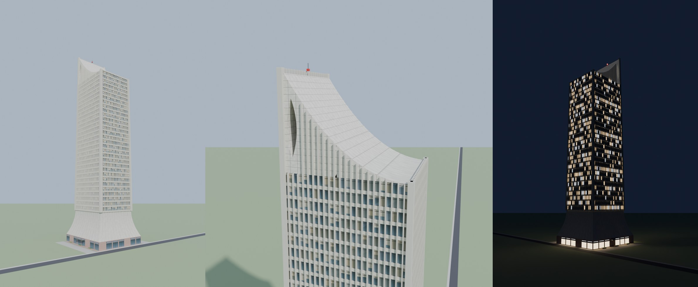

# Edificio Coltejer (Medellín): asset para Cities: Skylines II



Rascacielos emblemático de Medellín. Una torre de concreto con estrías verticales continuas se ensancha en curva hacia la base. El remate es la "punta de aguja": el techo sube en curva cóncava desde la fachada principal (145 m) hasta la trasera (175 m), y cerca de la punta lo atraviesa un ojo alargado.

## De dónde sale cada medida

| Elemento | Valor | Origen |
|---|---|---|
| Altura total | 175 m (más el pararrayos) | Dato publicado |
| Plantas | 36 (5 en la base + 31 tipo) | Dato publicado |
| Huella en la base | 42,7 × 47,6 m | Captura del modelo 3D de referencia (73,4 × 81,9 mm, con 301,1 mm = 175 m) |
| Base ensanchada en curva, estrías verticales, remate cóncavo con ojo | — | Captura de referencia (`referencia/captura_modelo_3d.png`) |
| Fuste de 32 × 37 m, arranque del remate a 145 m, ensanche hasta 26 m | — | **Estimado** a partir de la captura, que tiene perspectiva |
| Tamaño y posición exactos del ojo | — | **Estimado** |

Con capturas de frente y de lado del mismo modelo, o con el archivo `.stl`, puedo afinar estas medidas. Todas las cotas están al principio de `fuente/modelo_coltejer.py`.

## Detalles del modelo

| | |
|---|---|
| Parcela | 6 × 6 celdas (48 × 48 m) |
| LOD0 | 2.730 triángulos. Incluye estrías en las cuatro caras (en los laterales siguen la curva del remate), antepechos por planta, pilares de esquina, base ensanchada, locales en planta baja, remate cóncavo con ojo pasante, pararrayos, baliza roja, marquesinas laterales y jardineras |
| LOD1 | 1.012 triángulos: sin estrías ni antepechos salientes, curvas con menos segmentos |
| LOD2 | 60 triángulos: volumen básico |
| Texturas | Atlas de 4096 × 4096 px: color, relieve, MaskMap y Emissive |
| Noche | Luz en cerca de la mitad de las oficinas, con 8 variantes por planta para que no se repita. Locales encendidos, remate iluminado con reflectores y baliza roja |

## Archivos

```
CO_EdificioColtejer_6x6/
  CO_EdificioColtejer_6x6.fbx  /  _LOD1.fbx  /  _LOD2.fbx
  CO_EdificioColtejer_6x6_BaseColor.png
  CO_EdificioColtejer_6x6_Normal.png     (OpenGL, Y+)
  CO_EdificioColtejer_6x6_MaskMap.png    (R metálico, G oclusión, B 0, A suavidad)
  CO_EdificioColtejer_6x6_Emissive.png
referencia/
  captura_modelo_3d.png
fuente/
  texturas_coltejer.py   genera el atlas
  modelo_coltejer.py     construye el modelo, exporta los FBX y hace los renders
```

Las mallas están en metros con Y hacia arriba y el origen en el centro de la parcela, a ras de suelo. La fachada principal (la baja del remate) mira hacia -Y en Blender.

## Importarlo en el juego

1. Copia la carpeta `CO_EdificioColtejer_6x6` a tu carpeta de proyecto del importador de assets.
2. En el **editor de assets**, abre **Asset Importer**, selecciona la carpeta e impórtala. Las texturas se asignan por el nombre, y los sufijos distinguen mayúsculas.
3. Úsalo como **edificio emblemático (signature)** o como **oficinas de alta densidad**, con parcela de 6 × 6.
4. Comprueba la orientación respecto a la calle (gíralo si hace falta) y que los LOD1 y LOD2 quedan asociados.
5. Guárdalo, pruébalo de día y de noche, y publícalo en **Paradox Mods** si quieres compartirlo.

**Por revisar en el juego:**
- **MaskMap:** sigue la convención de Unity HDRP. No he podido confirmar cuál espera CS2.
- **Emissive:** no sé qué intensidad aplica CS2. Si de noche brilla demasiado o muy poco, cambia la intensidad de las luces en `texturas_coltejer.py`.

## Regenerar

Necesitas `pip install bpy numpy pillow` (Python 3.11+).

```
python fuente/texturas_coltejer.py CO_EdificioColtejer_6x6 CO_EdificioColtejer_6x6
python fuente/modelo_coltejer.py   CO_EdificioColtejer_6x6 CO_EdificioColtejer_6x6 render
```
