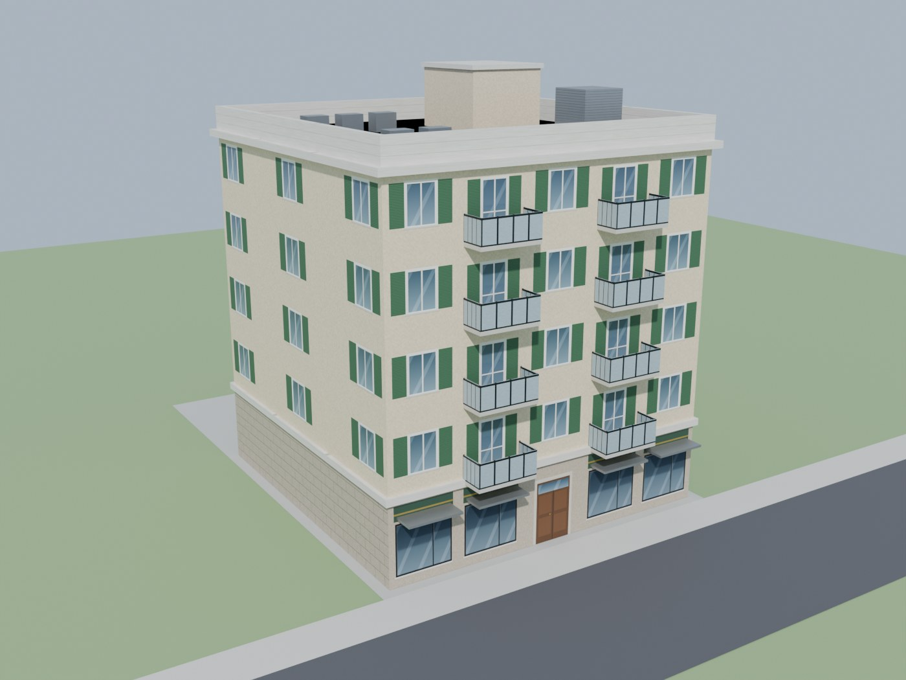

# Edificio Alameda: asset para Cities: Skylines II



Bloque de viviendas de estilo mediterráneo: planta baja con 4 locales comerciales y un portal, 4 plantas de pisos con contraventanas verdes y balcones, y una azotea con caja de escalera, aires acondicionados y depósito de agua.

| Dato | Valor |
|---|---|
| Parcela | 2 × 3 celdas (16 m × 24 m) |
| Huella del edificio | 15 m × 15 m, 18,3 m de alto con antepecho y escalera |
| LOD0 | 738 triángulos |
| LOD1 | 212 triángulos (sin balcones, toldos ni azotea) |
| Texturas | Un atlas cuadrado de 2048 × 2048 px en PNG de 8 bits |
| Pensado como | Residencial de densidad media, nivel 1 (crecible) |

## Archivos

```
EU_ResidencialAlameda_L1_2x3/
  EU_ResidencialAlameda_L1_2x3.fbx            malla principal (LOD0)
  EU_ResidencialAlameda_L1_2x3_LOD1.fbx       malla simplificada
  EU_ResidencialAlameda_L1_2x3_BaseColor.png  color
  EU_ResidencialAlameda_L1_2x3_Normal.png     relieve (convención OpenGL, Y+)
  EU_ResidencialAlameda_L1_2x3_MaskMap.png    R = metálico, G = oclusión, B = 0, A = suavidad
fuente/
  texturas.py   genera el atlas (numpy + Pillow)
  modelo.py     construye el modelo y exporta los FBX (Blender / bpy)
```

Los nombres siguen el patrón de la guía oficial de CS2, `<Tema>_<Nombre>_<Nivel>_<Parcela>_<LOD>`, y las texturas usan los sufijos `_BaseColor`, `_Normal` y `_MaskMap`. **Los sufijos distinguen mayúsculas**, así que no los renombres.

Las mallas están en metros, con Y hacia arriba (convención de Unity). El origen está en el centro de la parcela, a ras de suelo. La fachada con los locales es la que da a la calle.

## Importarlo en el juego

1. Copia la carpeta `EU_ResidencialAlameda_L1_2x3` a la carpeta de proyecto que uses con el importador de assets.
2. Abre el **Editor** desde el menú principal y entra en el **editor de assets**.
3. En el panel **Asset Importer**, selecciona esa carpeta e importa el asset. Las texturas se asignan solas por el nombre.
4. Elige una plantilla de **edificio residencial de densidad media** y pon el tamaño de parcela en 2 × 3.
5. Comprueba que la fachada de los locales mira hacia la calle. Si no es así, gira el edificio 180° en el editor.
6. Guarda el asset y pruébalo en una partida. Si quieres compartirlo, publícalo en **Paradox Mods** desde el propio editor.

## Cosas que conviene revisar

- **MaskMap:** he usado el reparto de canales de Unity HDRP (R metálico, G oclusión, A suavidad). No he podido confirmar el reparto exacto de CS2. Si el edificio sale demasiado brillante o metálico, revisa ese canal.
- **Ventanas:** están pintadas en la textura, así que de noche no se iluminan. Para luces nocturnas, CS2 usa una submalla de ventanas con sufijo `_Win` o un mapa `_Emissive`, y eso no está incluido.
- **LOD1:** si el importador no lo asocia solo, añádelo a mano como LOD de la malla principal.

## Modificarlo

Necesitas Python 3.11+ y `pip install bpy numpy pillow`.

```
python fuente/texturas.py EU_ResidencialAlameda_L1_2x3 EU_ResidencialAlameda_L1_2x3
python fuente/modelo.py   EU_ResidencialAlameda_L1_2x3 EU_ResidencialAlameda_L1_2x3 vista.png
```

En `modelo.py` puedes cambiar el número de plantas (`NF`), la huella (`W`, `D`) o qué módulo va en cada hueco de fachada. En `texturas.py` puedes cambiar colores como `PLASTER` (el enlucido) o el verde de las contraventanas.
